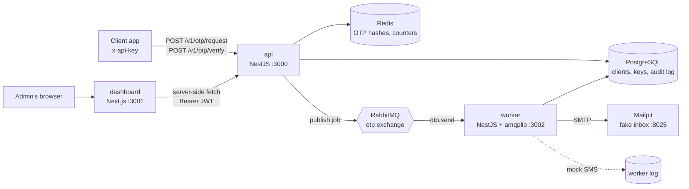
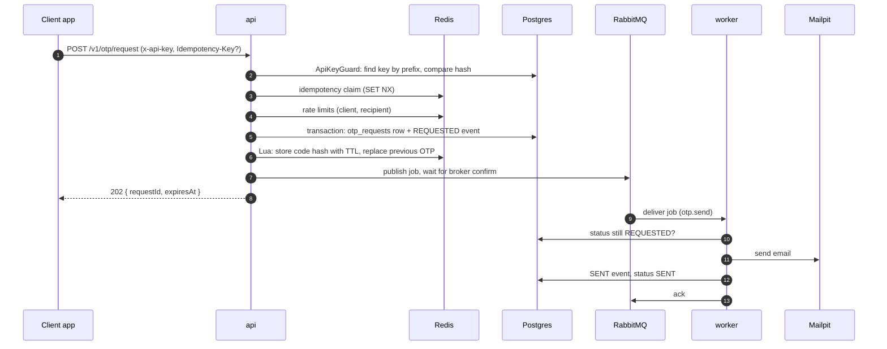
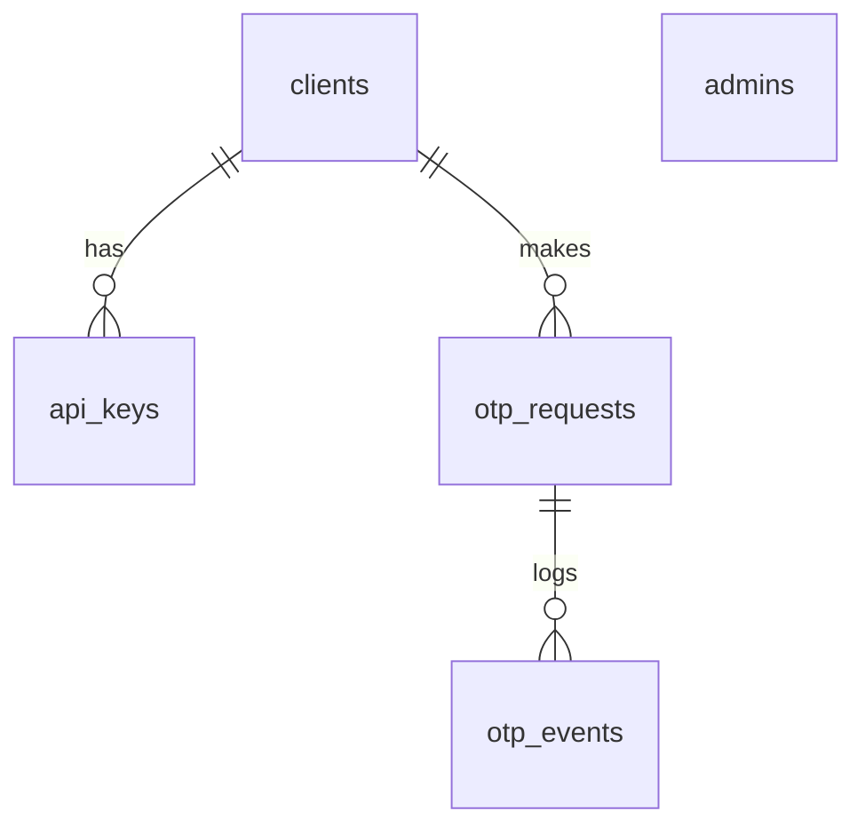
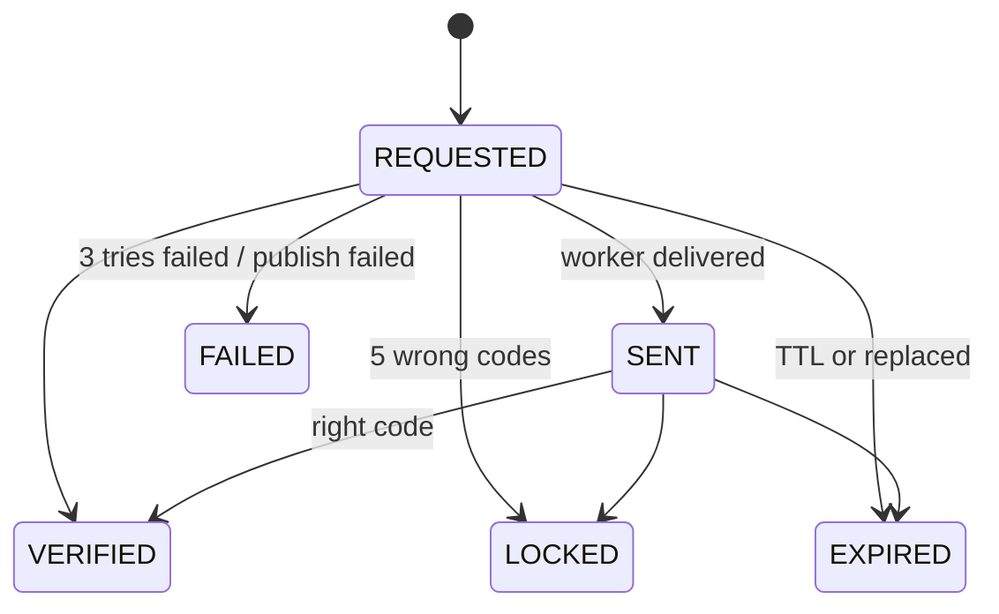
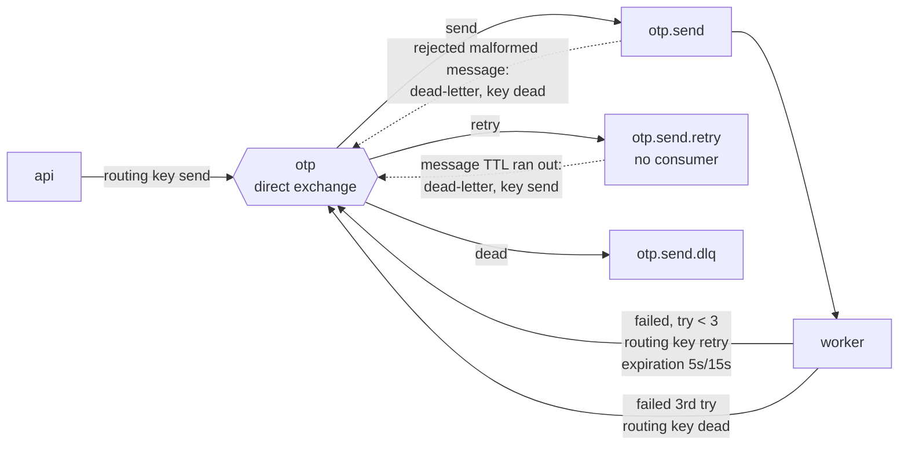
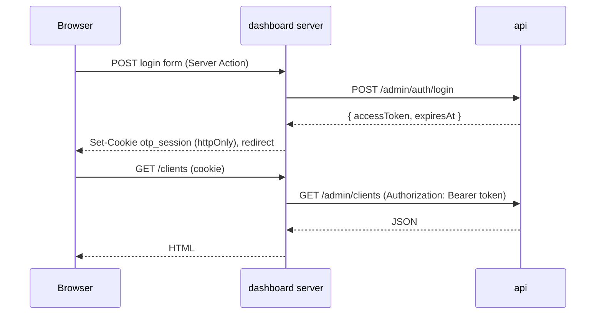

# How the OTP Gateway works

A guide to the code built in phases 1–7: what each part does, how a request travels through the
system, and why things are done the way they are. File links point at the code, so you can read
the explanation and the implementation side by side.

**Contents**

1. [The big picture](#1-the-big-picture)
2. [Repository map](#2-repository-map)
3. [Running it](#3-running-it)
4. [Requesting an OTP, step by step](#4-requesting-an-otp-step-by-step)
5. [Verifying an OTP](#5-verifying-an-otp)
6. [Where data lives](#6-where-data-lives)
7. [RabbitMQ: delivery, retries, DLQ](#7-rabbitmq-delivery-retries-dlq)
8. [The worker](#8-the-worker)
9. [The admin API](#9-the-admin-api)
10. [The dashboard (Next.js 16)](#10-the-dashboard-nextjs-16)
11. [Cross-cutting pieces](#11-cross-cutting-pieces)
12. [Security checklist (SRS §7)](#12-security-checklist-srs-7)
13. [Tests](#13-tests)
14. [Docker](#14-docker)
15. [Decisions, deviations from the SRS, and limits](#15-decisions-deviations-from-the-srs-and-limits)
16. [Check yourself](#16-check-yourself)

---

## 1. The big picture



| Part          | Job                                                                                                     | Talks to                  |
| ------------- | ------------------------------------------------------------------------------------------------------- | ------------------------- |
| **api**       | Public OTP API (request, verify), admin API, rate limits, idempotency                                   | Postgres, Redis, RabbitMQ |
| **worker**    | Takes send jobs off the queue, delivers by email or mock SMS, retries, records the result               | RabbitMQ, Postgres, SMTP  |
| **dashboard** | Admin UI. Never talks to the database: everything goes through the admin API                            | api                       |
| **Postgres**  | Data that must last: admins, clients, API keys, OTP requests and their events                           |                           |
| **Redis**     | Data that should expire by itself: OTP hashes, attempt counters, rate-limit counters, idempotency cache |                           |
| **RabbitMQ**  | Buffer between api and worker, with a retry queue and a dead-letter queue                               |                           |
| **Mailpit**   | Pretends to be an SMTP server and shows received emails in a web UI                                     |                           |

The key idea: **the api never sends anything itself.** It stores the OTP, writes the audit row,
puts a job on a queue and answers `202 Accepted` right away. Delivery (slow, can fail) happens in
the worker. That keeps `/otp/request` fast (NFR-09) and lets failed sends be retried.

## 2. Repository map

```
apps/
  api/                    NestJS: public + admin REST API
    prisma/               schema.prisma, migrations/, seed.ts   (the api owns the DB schema)
    src/
      config/             env validation (zod)
      common/             crypto helpers, API-key format, error filter, 429 exception
      prisma/ redis/      global providers for the DB and Redis (+ rate limiter)
      messaging/          RabbitMQ connection + job publisher
      auth/               ApiKeyGuard for client apps
      otp/                request/verify logic, Redis Lua scripts, idempotency, expiry sweeper
      admin/              login (JWT), clients & keys, logs, stats, test-send
      health/             /health/live and /health/ready
  worker/                 NestJS app whose real work is a RabbitMQ consumer
    src/consumer/         amqplib consumer, retry policy, job handler
    src/providers/        EmailProvider (nodemailer), MockSmsProvider
    src/database/         two SQL queries with `pg`
  dashboard/              Next.js 16 App Router
    app/login/            login page + Server Action
    app/(admin)/          logged-in pages: overview, clients, logs, test-send
    lib/                  session cookie, api client, types
    proxy.ts              redirect logged-out users (Next 16's name for middleware)
libs/shared/              code both api and worker need: queue names, job type, topology, statuses
tests/e2e/                Testcontainers end-to-end test
deploy/compose/           docker-compose.infra.yml (dev infra), docker-compose.yml (whole system)
```

`libs/shared` is the contract between the api (publisher) and the worker (consumer). If the job
shape or queue names lived in two places, one side could change and the other would silently
stop receiving messages. See [queue.ts](../libs/shared/src/queue.ts).

## 3. Running it

**Day-to-day development** (apps run on your machine with hot reload, infra in Docker):

```powershell
Copy-Item .env.example .env        # once; then change the secrets
pnpm install                       # also builds libs/shared and generates the Prisma client
pnpm infra:up                      # Postgres, Redis, RabbitMQ, Mailpit
pnpm --filter api db:deploy        # apply migrations (db:migrate when you change the schema)
pnpm --filter api db:seed          # admin user + a demo client; prints the demo API key once
pnpm --filter api start:dev        # http://localhost:3000, Swagger at /docs
pnpm --filter worker start:dev     # health on http://localhost:3002/health/ready
pnpm --filter dashboard dev        # http://localhost:3001  (admin@otp.local / admin12345)
```

**Everything in containers** (what a fresh clone needs, no Node install required):

```powershell
pnpm stack:up      # builds 3 images + migration job, waits until all healthy
pnpm stack:down
```

Both use ports 3000–3002, so run one mode at a time. Useful UIs: RabbitMQ
<http://localhost:15672> (otp / otp_dev_password), Mailpit <http://localhost:8025>.

**Checks**: `pnpm lint`, `pnpm typecheck`, `pnpm test` (unit), `pnpm test:e2e` (builds, then runs
the Testcontainers suite).

## 4. Requesting an OTP, step by step



What each step does, and where:

1. **Authenticate the client.** [api-key.guard.ts](../apps/api/src/auth/api-key.guard.ts) reads
   `x-api-key`. A key looks like `otp_4ccf4987179f.LO63oj…`: the part before the dot (prefix) is
   stored in plain text and indexed, so the row can be found; the whole key is stored only as a
   SHA-256 hash and compared with `timingSafeEqual`. Format and hashing live in
   [api-key.ts](../apps/api/src/common/api-key.ts).
2. **Idempotency** (NFR-07). If the client sent `Idempotency-Key`,
   [idempotency.service.ts](../apps/api/src/otp/idempotency.service.ts) claims
   `idem:{clientId}:{key}` with `SET NX`. A retry of the same request gets the first response back
   (header `Idempotent-Replayed: true`); the same key with a different body gets `422`; a retry
   while the first is still running gets `409`.
3. **Validate and normalise the recipient.** `Alice@Example.com ` and `alice@example.com` must count
   as the same person: [recipient.ts](../apps/api/src/otp/recipient.ts).
4. **Rate limits** (FR-06). [rate-limiter.service.ts](../apps/api/src/redis/rate-limiter.service.ts)
   is a fixed-window counter: a Lua script runs `INCR`, and on the first hit `EXPIRE`. Per client:
   `clients.rate_limit_per_min` per 60 s. Per recipient: 3 per 10 min. Over the limit → `429` with
   `Retry-After`.
5. **Generate the code.** `crypto.randomInt(0, 1_000_000)`, padded to 6 digits. Never
   `Math.random()`, which is predictable.
6. **Write the audit trail first**, in one Prisma transaction: the `otp_requests` row and its
   `REQUESTED` event commit together or not at all.
7. **Store the code hash in Redis.** [otp.store.ts](../apps/api/src/otp/otp.store.ts), `SAVE_SCRIPT`:
   deletes the recipient's previous OTP (FR-07), writes `otp:{requestId}` with a 5-minute TTL, and
   points `otp:active:{clientId}:{recipientHash}` at the new id, atomically. The replaced request is
   then marked `EXPIRED` with reason `replaced`.
8. **Publish the job** after the DB commit
   ([otp-job.publisher.ts](../apps/api/src/messaging/otp-job.publisher.ts)). The api waits for the
   broker's _publisher confirm_, i.e. RabbitMQ saying "stored". If publishing fails, the OTP is
   removed, the request is marked `FAILED` and the client gets `503`.
9. **Answer `202`** with `requestId` and `expiresAt`. The plain code is now only in the job message.

All of this is orchestrated in [otp.service.ts](../apps/api/src/otp/otp.service.ts) `request()`.

## 5. Verifying an OTP

`POST /v1/otp/verify { requestId, code }` → [otp.service.ts](../apps/api/src/otp/otp.service.ts)
`verify()`.

The tricky part is concurrency. If two verify calls arrive at the same time, a naive "read attempts,
check, increment" can let both through. So the check-and-count is one Lua script
(`RESERVE_ATTEMPT_SCRIPT` in [otp.store.ts](../apps/api/src/otp/otp.store.ts)) that Redis runs
atomically:

```
key missing, or belongs to another client  ->  {0}            "missing"
attempts >= 5                               ->  {2, attempts}  "locked"
otherwise attempts += 1                     ->  {1, attempts, codeHash, recipientHash}
```

Then, in Node:

| Situation                                      | Response                    | Side effects                         |
| ---------------------------------------------- | --------------------------- | ------------------------------------ |
| Hash matches and this call deleted the key     | `200 { verified: true }`    | `VERIFIED` event, `verified_at` set  |
| Hash matches but another call deleted it first | `410` already used          | none (single use, even under a race) |
| Wrong code, attempts < 5                       | `400 { attemptsRemaining }` | attempts saved                       |
| Wrong code, 5th attempt                        | `423`                       | `LOCKED` event                       |
| Locked (any code, even the right one)          | `423`                       | none                                 |
| Key gone, request was verified                 | `410` already used          | none                                 |
| Key gone otherwise                             | `410` expired               | `EXPIRED` event                      |
| Unknown id (or another client's)               | `404`                       | none                                 |

The code is compared as `HMAC-SHA256(secret, "otp:{requestId}:{code}")` with `timingSafeEqual`
([crypto.ts](../apps/api/src/common/crypto.ts)). Why a keyed hash? There are only a million 6-digit
codes, so a plain SHA-256 could be brute-forced from a leaked Redis dump in seconds; without the
HMAC secret it can't. Including the requestId means a code can't be replayed against another request.

**Expiry in Postgres.** Redis forgets an expired OTP by itself, but Postgres would keep saying `SENT`.
[expiry-sweeper.service.ts](../apps/api/src/otp/expiry-sweeper.service.ts) runs once a minute: one
SQL statement (`UPDATE … RETURNING` inside a CTE, then `INSERT` events) marks overdue `REQUESTED`/`SENT`
requests as `EXPIRED`. `FAILED` is final and left alone.

## 6. Where data lives

### Postgres ([schema.prisma](../apps/api/prisma/schema.prisma))



| Table          | Notes                                                                                                                |
| -------------- | -------------------------------------------------------------------------------------------------------------------- |
| `admins`       | `password_hash` is argon2 (slow on purpose, see §9)                                                                  |
| `clients`      | `status` active/revoked, `rate_limit_per_min`                                                                        |
| `api_keys`     | `prefix` (unique, indexed), `key_hash`, `last_used_at`, `revoked_at`                                                 |
| `otp_requests` | `id` = requestId, `recipient_masked` + `recipient_hash` (never the real address), `status`, `attempts`, `expires_at` |
| `otp_events`   | append-only audit log: `type` + `detail` (jsonb)                                                                     |

Lifecycle of `otp_requests.status`:



Prisma 7 notes: the client is generated into `apps/api/src/generated/prisma` (git-ignored, created
by `pnpm install`), the DB URL lives in [prisma.config.ts](../apps/api/prisma.config.ts) instead of
the schema, and the client connects through a driver adapter (`@prisma/adapter-pg`) in
[prisma.service.ts](../apps/api/src/prisma/prisma.service.ts).

### Redis

| Key                                     | Value                                                     | TTL                           |
| --------------------------------------- | --------------------------------------------------------- | ----------------------------- |
| `otp:{requestId}`                       | hash: `codeHash`, `attempts`, `recipientHash`, `clientId` | OTP TTL (5 min)               |
| `otp:active:{clientId}:{recipientHash}` | current requestId for that recipient                      | OTP TTL                       |
| `rl:client:{clientId}`                  | counter                                                   | 60 s                          |
| `rl:recipient:{recipientHash}`          | counter                                                   | 10 min                        |
| `rl:login:{sha256(email)}`              | admin login attempts                                      | 15 min                        |
| `idem:{clientId}:{key}`                 | `{ state, fingerprint, response }`                        | 60 s while pending, then 24 h |

Rule of thumb: if losing it on a Redis restart is fine (an OTP the user can re-request, a counter),
it goes in Redis. If you'd want it in an audit or a report, it goes in Postgres.

## 7. RabbitMQ: delivery, retries, DLQ

The topology is declared from one function, `assertOtpTopology()` in
[queue.ts](../libs/shared/src/queue.ts), by both api and worker on every (re)connect. Declaring is
idempotent, but the arguments must match exactly, which is why it's shared code.



- **Exchange vs queue.** Publishers send to an _exchange_ with a _routing key_; _bindings_ decide
  which queues get a copy. Nobody publishes straight to `otp.send.retry`; the exchange routes there.
- **Delayed retry without a plugin.** A failed job is re-published with a per-message
  `expiration`. Nobody consumes the retry queue, so the message just sits there; when it expires,
  the queue's `x-dead-letter-exchange` sends it back to `otp.send`. Delays: 5 s, then 15 s, then
  the job goes to the DLQ (FR-08).
- **Manual ack + prefetch.** The worker acks a message only after it's fully handled. If the worker
  dies first, RabbitMQ re-delivers it (NFR-06). `prefetch(10)` caps how many unacked messages one
  worker holds, so work spreads across replicas.
- **At-least-once.** Re-delivery means the same job can arrive twice, so the handler must be
  idempotent: it only sends while the request is still `REQUESTED`.
- **Publish after commit, and its gap.** The api commits to Postgres, _then_ publishes. If the
  process crashes between the two, the request exists but no job does. Here the client simply gets
  an error or times out and requests again. The full fix is the **outbox pattern**: write the job
  into an `outbox` table in the same transaction, and let a relay publish it.
- **Reconnects.** amqplib 2's `recovery` option reconnects with exponential backoff and calls our
  `setup()` again, which recreates the channel, topology and consumer
  ([rabbitmq.service.ts](../apps/api/src/messaging/rabbitmq.service.ts),
  [otp-consumer.service.ts](../apps/worker/src/consumer/otp-consumer.service.ts)).

## 8. The worker

The worker is a Nest app (for DI, config and logging) whose real work is a plain amqplib consumer,
so every RabbitMQ step is visible instead of hidden in `@nestjs/microservices`. It still listens on
HTTP 3002, only for the health probes.

Three layers, each easy to test on its own:

| File                                                                           | Responsibility                                                                                                   |
| ------------------------------------------------------------------------------ | ---------------------------------------------------------------------------------------------------------------- |
| [otp-consumer.service.ts](../apps/worker/src/consumer/otp-consumer.service.ts) | RabbitMQ only: parse, ack/nack, publish to retry or DLQ (with confirms, _before_ acking the original)            |
| [send-otp.handler.ts](../apps/worker/src/consumer/send-otp.handler.ts)         | Business decision: skip if not `REQUESTED`, pick the provider, record `SENT`/`FAILED`, return what should happen |
| [retry-policy.ts](../apps/worker/src/consumer/retry-policy.ts)                 | Pure function: retry with which delay, or give up                                                                |

Providers implement one interface ([channel-provider.ts](../apps/worker/src/providers/channel-provider.ts)).
Adding a real SMS provider means one new class; nothing else changes.

The worker writes to Postgres with plain SQL via `pg` ([database.service.ts](../apps/worker/src/database/database.service.ts)),
not Prisma: two queries don't need an ORM, and the api stays the only owner of schema and migrations.
Each write is a single statement (CTE: conditional `UPDATE` + `INSERT` event), so it's atomic, and
the `UPDATE` only moves `REQUESTED → SENT`, so a late delivery can never overwrite `VERIFIED`.

Want to see retries? Set `WORKER_SIMULATE_FAILURE=true`, restart the worker, request an OTP, and
watch the message move through `otp.send.retry` into `otp.send.dlq` in the RabbitMQ UI.

## 9. The admin API

Two kinds of callers, two kinds of credentials:

| Caller                | Credential                                            | Why                                              |
| --------------------- | ----------------------------------------------------- | ------------------------------------------------ |
| Client apps (`/v1/*`) | API key in `x-api-key`                                | Long-lived machine credential; revocable per key |
| Admin (`/admin/*`)    | JWT, in an httpOnly cookie or `Authorization: Bearer` | Short-lived (8 h) session for a person           |

- **Login** ([admin-auth.service.ts](../apps/api/src/admin/auth/admin-auth.service.ts)): argon2
  verify, rate limited to 10 tries per 15 min per email. An unknown email still runs a dummy argon2
  verify, so both failures take the same time. Passwords use argon2 (slow, memory-hard) because
  humans pick guessable ones; API keys use SHA-256 because they're 256 random bits.
- **Cookie flags** ([admin-auth.controller.ts](../apps/api/src/admin/auth/admin-auth.controller.ts)):
  `HttpOnly` (JavaScript can't read it, so XSS can't steal it), `SameSite=Lax` (not sent on
  cross-site POSTs, which blocks most CSRF), `Secure` in production.
- **Guards vs middleware.** Middleware runs before routing and doesn't know which handler will run.
  Guards run after routing, can read handler metadata, and return yes/no, which is why auth is a
  guard ([jwt-auth.guard.ts](../apps/api/src/admin/auth/jwt-auth.guard.ts)). Request order:
  middleware → guards → interceptors → pipes → handler → exception filters.
- **Clients and keys** ([clients.service.ts](../apps/api/src/admin/clients/clients.service.ts)): the
  full key is returned once, at creation; only the hash is stored. `keyHash` is never selected into
  a response. Revoking a client revokes all its keys; rows stay for the audit log.
- **Logs with cursor pagination** ([logs.service.ts](../apps/api/src/admin/logs/logs.service.ts)).
  `?page=50` (offset) makes Postgres read and discard every earlier row, and pages shift when new rows
  arrive. The cursor encodes the last row seen `(created_at, id)` and asks for rows "older than that",
  which uses the index and stays stable. Searching by recipient works by hashing the search term the
  same way, so the plain address is never stored.
- **Stats** ([stats.service.ts](../apps/api/src/admin/stats/stats.service.ts)): `generate_series`
  makes one row per day and the `LEFT JOIN` keeps empty days at 0; `count(*) FILTER (WHERE …)` counts
  several statuses in one pass.
- **Swagger** at <http://localhost:3000/docs>. The `@nestjs/swagger` CLI plugin (in
  [nest-cli.json](../apps/api/nest-cli.json)) reads DTO types, class-validator rules and `/** comments */`,
  so DTOs need almost no `@ApiProperty` decorators.

| Method             | Path                                                                         | Purpose                               |
| ------------------ | ---------------------------------------------------------------------------- | ------------------------------------- |
| POST               | `/admin/auth/login`, `/admin/auth/logout`; GET `/admin/auth/me`              | session                               |
| GET, POST          | `/admin/clients`                                                             | list, create (returns first key once) |
| GET, PATCH, DELETE | `/admin/clients/:id`                                                         | read, rename / change limit, revoke   |
| POST               | `/admin/clients/:id/keys`                                                    | new key (returned once)               |
| DELETE             | `/admin/clients/:id/keys/:keyId`                                             | revoke key                            |
| GET                | `/admin/logs?status=&channel=&clientId=&recipient=&from=&to=&cursor=&limit=` | audit log                             |
| GET                | `/admin/logs/:id`                                                            | one request with its events           |
| GET                | `/admin/stats?days=14`                                                       | daily counts                          |
| POST               | `/admin/test/request`, `/admin/test/verify`                                  | test-send page (FR-13)                |

## 10. The dashboard (Next.js 16)



The browser never talks to the api and never sees the token in JavaScript. The dashboard's server
holds it in its own httpOnly cookie ([session.ts](../apps/dashboard/lib/session.ts)) and forwards it
([api.ts](../apps/dashboard/lib/api.ts)). That's also why `API_BASE_URL` has no `NEXT_PUBLIC_`
prefix: only server code uses it. `NEXT_PUBLIC_*` variables are baked into the browser JavaScript at
_build_ time, so they can't change per environment; `MAILPIT_URL` is read on the server at request
time and passed down as a prop instead.

Concepts used, and where:

| Concept                     | Where                                                                                                                                      | What to notice                                                                                                                                                      |
| --------------------------- | ------------------------------------------------------------------------------------------------------------------------------------------ | ------------------------------------------------------------------------------------------------------------------------------------------------------------------- |
| Server Components           | every `page.tsx`                                                                                                                           | async functions that `await api(...)` directly; no client-side fetching                                                                                             |
| Client Components           | `'use client'` files: forms, chart, nav                                                                                                    | only where there's state, events or browser APIs (Recharts measures SVG)                                                                                            |
| Server Actions              | `actions.ts` files                                                                                                                         | functions marked `'use server'`, called by `<form action>`. They also work with JavaScript off                                                                      |
| `useActionState`            | [login-form.tsx](../apps/dashboard/app/login/login-form.tsx), [client-forms.tsx](<../apps/dashboard/app/(admin)/clients/client-forms.tsx>) | gets the action's return value (errors, the new key) and a `pending` flag                                                                                           |
| `refresh()`                 | [clients/actions.ts](<../apps/dashboard/app/(admin)/clients/actions.ts>)                                                                   | re-renders the current page on the server after a change                                                                                                            |
| `proxy.ts`                  | [proxy.ts](../apps/dashboard/proxy.ts)                                                                                                     | Next 16's new name for middleware. An _optimistic_ check (cookie present and not expired); the api still verifies the JWT on every call                             |
| Cache Components            | [next.config.ts](../apps/dashboard/next.config.ts)                                                                                         | pages get a static shell; anything reading cookies or `searchParams` must sit inside `<Suspense>`, which is why every page renders a skeleton then streams the data |
| Route group                 | `app/(admin)/`                                                                                                                             | the parentheses group pages under one layout (sidebar) without adding `/admin` to the URL                                                                           |
| `loading.tsx` / `error.tsx` | [(admin)/](<../apps/dashboard/app/(admin)/>)                                                                                               | instant skeleton on navigation; error boundary with a `retry()` button                                                                                              |
| Filters in the URL          | [logs/page.tsx](<../apps/dashboard/app/(admin)/logs/page.tsx>)                                                                             | `next/form` turns a GET form into a client-side navigation, so filtered views can be bookmarked                                                                     |
| Standalone output           | `output: 'standalone'`                                                                                                                     | builds a minimal server for the Docker image                                                                                                                        |

## 11. Cross-cutting pieces

- **Config that fails fast**: [env.validation.ts](../apps/api/src/config/env.validation.ts) (api) and
  the worker's twin. A missing or malformed variable stops the app at boot with a readable list, not
  on the first request. `.env` files are read from the app folder and the repo root; real
  environment variables always win.
- **One error shape**: [all-exceptions.filter.ts](../apps/api/src/common/filters/all-exceptions.filter.ts)
  turns every error into `{ statusCode, error, message, …extra, requestId, path, timestamp }`. Unknown
  errors become a plain 500 (details go to the log, not the client). `RateLimitedException` adds the
  `Retry-After` header.
- **Validation**: a global `ValidationPipe` with `whitelist` + `forbidNonWhitelisted` rejects unknown
  fields and runs the class-validator rules on every DTO. It's registered as `APP_PIPE` in
  [app.module.ts](../apps/api/src/app.module.ts), so it also applies in tests.
- **Logging**: `nestjs-pino`, JSON in production, pretty in development. Each request gets an
  `x-request-id` (or reuses the caller's), which appears on every log line and in error responses.
  API keys, cookies and auth headers are redacted.
- **Health probes**: `/health/live` checks nothing but the process (a DB outage must not restart every
  pod); `/health/ready` checks DB, Redis and RabbitMQ (failing it just stops traffic to the pod).
- **Graceful shutdown**: `enableShutdownHooks()` + `onApplicationShutdown` close Redis, Prisma, the
  pg pool and the RabbitMQ connection on SIGTERM. The worker's unacked messages go back to the queue.

## 12. Security checklist (SRS §7)

| Requirement                                    | How                                                                                                                                     |
| ---------------------------------------------- | --------------------------------------------------------------------------------------------------------------------------------------- |
| NFR-01 OTP only as HMAC, constant-time compare | `hashCode()` + `safeEqualHex()` in [otp.service.ts](../apps/api/src/otp/otp.service.ts) / [crypto.ts](../apps/api/src/common/crypto.ts) |
| NFR-02 API keys hashed, shown once             | [api-key.ts](../apps/api/src/common/api-key.ts), [clients.service.ts](../apps/api/src/admin/clients/clients.service.ts)                 |
| NFR-03 secrets from the environment            | zod-validated env; `.env` is git-ignored and Docker-ignored; dev defaults only in compose                                               |
| NFR-04 masked recipients                       | stored masked + hashed; [recipient.ts](../apps/api/src/otp/recipient.ts)                                                                |
| Plain codes never in Postgres                  | only in Redis as HMAC and in the queue message (private network)                                                                        |
| Brute force                                    | 5 attempts then lock; per-recipient and per-client rate limits; admin login rate limit                                                  |
| Admin session                                  | httpOnly + SameSite cookie, short JWT, CORS limited to the dashboard origin                                                             |
| Containers                                     | non-root user, no package manager in runtime images, ports bound to 127.0.0.1 in compose                                                |

## 13. Tests

| Kind       | Where                                                                                                                                                                                                           | What it proves                                                                                                                                                                             |
| ---------- | --------------------------------------------------------------------------------------------------------------------------------------------------------------------------------------------------------------- | ------------------------------------------------------------------------------------------------------------------------------------------------------------------------------------------ |
| Unit       | [otp.service.spec.ts](../apps/api/src/otp/otp.service.spec.ts)                                                                                                                                                  | request/verify rules with Redis, Prisma and the publisher mocked                                                                                                                           |
| Unit       | [api-key.guard.spec.ts](../apps/api/src/auth/api-key.guard.spec.ts), [idempotency.service.spec.ts](../apps/api/src/otp/idempotency.service.spec.ts), [recipient.spec.ts](../apps/api/src/otp/recipient.spec.ts) | guard cases, idempotency races (with a tiny in-memory fake Redis), masking                                                                                                                 |
| Unit       | [send-otp.handler.spec.ts](../apps/worker/src/consumer/send-otp.handler.spec.ts), [retry-policy.spec.ts](../apps/worker/src/consumer/retry-policy.spec.ts)                                                      | skip duplicates, retry vs DLQ                                                                                                                                                              |
| End-to-end | [tests/e2e](../tests/e2e/src/otp-flow.e2e-spec.ts)                                                                                                                                                              | real Postgres, Redis, RabbitMQ, Mailpit in throwaway containers; the built api and worker as processes; request → email → read the code from Mailpit's API → verify; lock-out; idempotency |

What to mock: the things _outside_ the unit (DB, Redis, broker), so a unit test checks one class's
decisions. What not to mock: the Lua scripts and SQL, since mocking them would only test the mock.
That's what the e2e test is for. [stack.ts](../tests/e2e/src/stack.ts) starts the apps with a temp
directory as working dir, so your local `.env` can't leak into the test.

## 14. Docker

Each [Dockerfile](../apps/api/Dockerfile) builds from the **repo root** (it needs the root lockfile
and `libs/shared`):

```
base     node:26-alpine
deps     copy only lockfile + workspace files, pnpm fetch      -> cached until dependencies change
build    copy source, pnpm install --offline, build, pnpm deploy --prod -> /out
migrate  (api only) prisma migrate deploy + seed, as a one-off container
runtime  alpine:3.24 + the node binary + /out, user `node`
```

- **Layer caching**: the slow download step only depends on the lockfile, so editing code doesn't
  re-download packages. `--mount=type=cache` keeps the pnpm store between builds.
- **`pnpm deploy --prod`** copies one package plus only its production dependencies (including
  workspace packages like `@otp/shared`).
- **Runtime without npm**: Node 25+ no longer ships Corepack, and the runtime doesn't need npm, pnpm
  or headers at all, so the final stage copies just the `node` binary onto plain Alpine.
- **[.pnpmfile.cjs](../.pnpmfile.cjs)**: `@prisma/client` declares the Prisma CLI and TypeScript as
  optional peers. Because the api has the CLI as a dev dependency, pnpm bundled them into the
  production tree (~200 MB). The hook removes those peers; the api image went from 769 MB to 276 MB.
  Unused Prisma query compilers (MySQL, SQLite, …) are deleted in the build stage too.
- **Sizes** (unpacked / compressed): api 276 / 77 MB, worker 220 / 64 MB, dashboard 194 / 68 MB.
  The Node 26 binary alone is 139 MB unpacked, which is why the unpacked numbers sit near or above
  the plan's ~200 MB target; the compressed size is what a registry stores and a node pulls.
- **Compose**: [docker-compose.yml](../deploy/compose/docker-compose.yml) `include`s the infra file,
  then adds `migrate` (the api waits for `service_completed_successfully`), `api`, `worker`,
  `dashboard`, each with a healthcheck. Containers find each other by service name
  (`postgres:5432`, `http://api:3000`).

## 15. Decisions, deviations from the SRS, and limits

| Topic            | Choice                                                                          | Why                                                                                                                                                                                                       |
| ---------------- | ------------------------------------------------------------------------------- | --------------------------------------------------------------------------------------------------------------------------------------------------------------------------------------------------------- |
| Active-OTP key   | `otp:active:{clientId}:{recipientHash}` instead of `otp:active:{recipientHash}` | two different client apps sending a code to the same person shouldn't cancel each other's OTP                                                                                                             |
| `FAILED`         | final, never turned into `EXPIRED`                                              | failures must stay visible in stats ("failures per day")                                                                                                                                                  |
| 5th wrong code   | returns `423` (not `400` then `423`)                                            | the attempt that triggers the lock reports it                                                                                                                                                             |
| Retry backoff    | per-message TTL in one retry queue                                              | simple and visible. Limit: RabbitMQ only expires the message at the _head_ of a queue, so a 15 s message can hold back a 5 s one behind it. Fix: one retry queue per delay, or the delayed-message plugin |
| Worker DB access | `pg` + SQL, not Prisma                                                          | two queries; api owns the schema                                                                                                                                                                          |
| NestJS 11        | not 12                                                                          | Nest 12 is ESM-only; the generated apps are CommonJS and Jest's ESM support is still awkward                                                                                                              |
| TypeScript ~6.0  | not 7                                                                           | typescript-eslint, Nest CLI and ts-jest need the TypeScript JS API                                                                                                                                        |
| Node 26          | kept                                                                            | it's the current LTS; Prisma prints a "not officially supported" warning but works                                                                                                                        |
| JWT logout       | forget the cookie                                                               | stateless JWTs stay valid until they expire; a denylist in Redis would be the next step                                                                                                                   |

**Not built yet**: FR-15 (view and replay DLQ messages from the dashboard), the outbox pattern,
the optional Playwright test, and phases 8–11 (CI, Kubernetes, AWS, CD).

## 16. Check yourself

Questions an interviewer could ask about this project; the answers are in the sections above.

1. Why does `/otp/request` return `202` instead of `200`?
2. Two verify calls with the right code arrive at the same millisecond. Which code makes sure only
   one succeeds?
3. Why HMAC for OTP codes, SHA-256 for API keys and argon2 for passwords?
4. What does `prefetch(10)` change, and what happens to unacked messages when a worker crashes?
5. The api committed the request but crashed before publishing. What does the user see, and how
   would the outbox pattern fix it?
6. Why is `/health/live` not allowed to check the database?
7. Why can't `MAILPIT_URL` be a `NEXT_PUBLIC_` variable if one image must run in every environment?
8. Why does cursor pagination stay correct while new rows are being inserted?
9. What would break if the api and worker declared `otp.send` with different arguments?
10. Why does the Docker build copy the lockfile before the source code?
